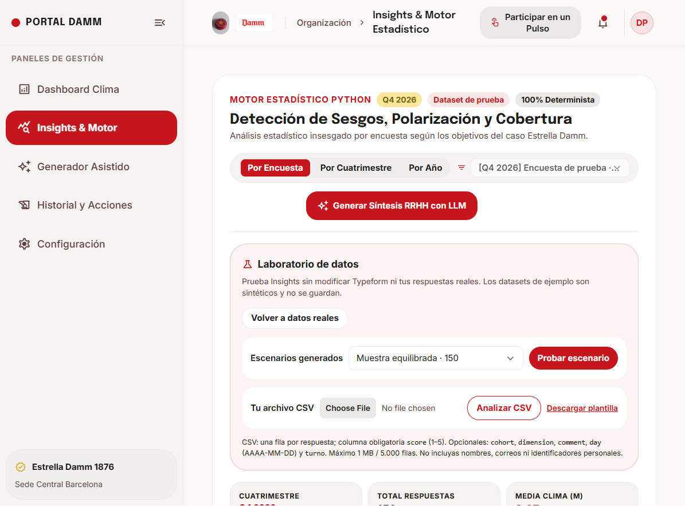
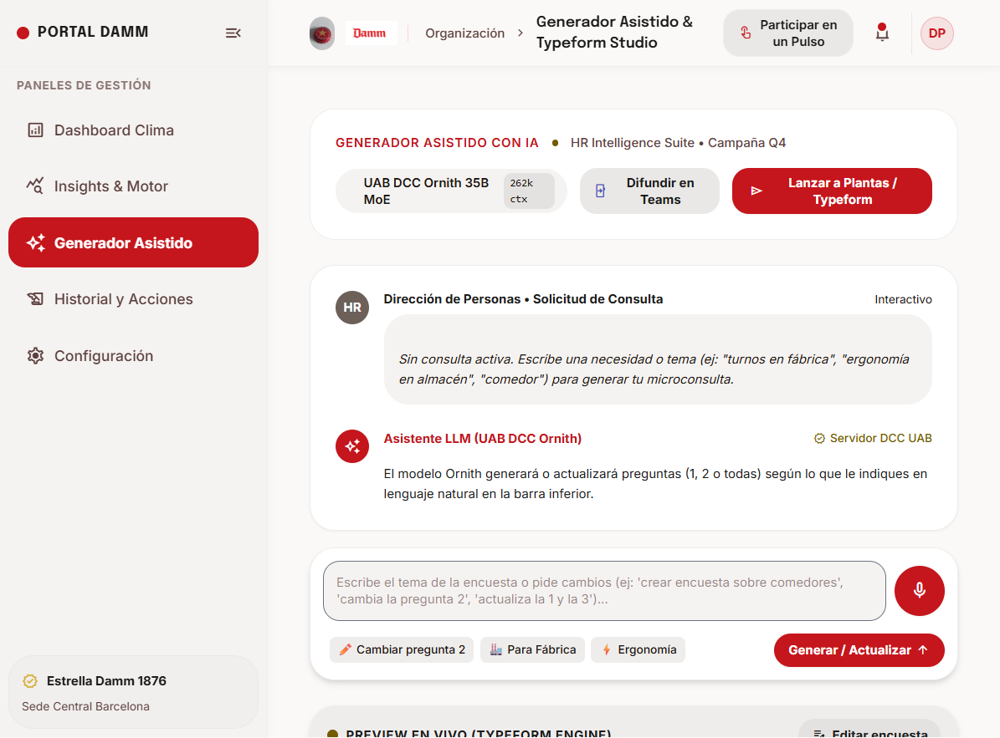

<div align="center">

# 🍺 Pulso

### Escuchar mejor. Entender antes. Actuar con criterio.

Plataforma de escucha activa y analítica de clima laboral para **Estrella Damm**, creada para **UAB THE HACK 2026**.


</div>

<p align="center">
  
</p>

<p align="center"><em>Prueba escenarios y archivos CSV sin mezclarlos con las respuestas reales.</em></p>

**Pulso** combina encuestas breves, análisis estadístico reproducible y asistencia de IA en una experiencia pensada para Fábrica, Logística, Oficinas y Comercial. Los números los calcula un motor determinista; las síntesis con IA son una capa de apoyo, no sustituyen la revisión de RR. HH.

**[Características](#-qué-puedes-hacer) · [Capturas](#-pulso-por-dentro) · [Inicio rápido](#-inicio-rápido) · [Configuración](#-integraciones-opcionales) · [Privacidad](#-privacidad-y-seguridad) · [Tests](#-verificación)**

---

## ✨ Qué puedes hacer

- **Entender el clima:** indicadores y tendencias por periodo, dimensión y colectivo.
- **Analizar con rigor:** medias, medianas, dispersión, participación, representatividad y alertas de polarización con cálculos deterministas.
- **Probar antes de usar:** escenarios sintéticos o un CSV propio en un laboratorio aislado. La prueba no modifica Typeform ni se guarda como una encuesta real.
- **Diseñar consultas:** genera o refina preguntas en lenguaje natural y revisa una vista previa de la encuesta.
- **Conectar con Typeform:** publicar encuestas e importar respuestas cuando configures el token.
- **Mantener control humano:** consultar el historial y revisar las acciones antes de aplicarlas.
- **Proteger a las personas:** los resultados de grupos con menos de cinco respuestas se ocultan y los comentarios se sanitizan antes de guardarse.

## 🖥️ Pulso por dentro

<table>
  <tr>
    <td align="center" width="50%">
      <strong>Generador asistido</strong><br>
      
    </td>
    <td align="center" width="50%">
      <strong>Resultados por pregunta</strong><br>
      
    </td>
  </tr>
</table>

Las vistas de Insights y del carrusel usan una muestra sintética; no incluyen respuestas reales.

## 🚀 Inicio rápido

Necesitas **Python 3.10 o superior**.

```powershell
git clone https://github.com/IgnaciDM/Damn.git
cd Damn
python -m venv .venv
.\.venv\Scripts\Activate.ps1
python -m pip install -r requirements.txt
python -m backend.app
```

En macOS o Linux, activa el entorno con:

```bash
source .venv/bin/activate
```

Abre **[http://127.0.0.1:8000](http://127.0.0.1:8000)**. El servidor sirve la interfaz y la API; no hace falta compilar un frontend. Sin credenciales puedes explorar el modo de demostración.

## 🔌 Integraciones opcionales

Para configurar servicios externos, copia `.env.example` a `.env` y añade tus propias credenciales. También puedes configurar las conexiones desde la sección **Configuración** de la aplicación.

| Variable | Para qué sirve |
|---|---|
| `UTH_KEY` | Acceso al modelo de lenguaje de la UAB. |
| `AI_MODEL`, `AI_BASE_URL` | Modelo y endpoint del servicio de IA. |
| `GEMINI_API_KEY` | Alternativa de proveedor para generación asistida. |
| `TYPEFORM_API_TOKEN` | Publicar encuestas e importar respuestas de Typeform. |
| `PULSO_PUBLIC_URL` | Crear enlaces y QR accesibles desde otros dispositivos. |
| `PULSO_DATABASE` | Cambiar la ruta de la base de datos SQLite. |
| `VOSK_MODEL_PATH` | Ruta local al modelo Vosk de voz en español. |

### Dictado por voz

El generador puede transcribir instrucciones con Vosk localmente. Descarga y descomprime el modelo español `vosk-model-small-es-0.42` y configura `VOSK_MODEL_PATH` con su ubicación (la ruta predeterminada está en `.env.example`). El dictado necesita un navegador con permiso de micrófono; en `localhost` no hace falta HTTPS. El audio no se guarda.

## 🗂️ Estructura

```text
backend/
  app.py                 Servidor HTTP y rutas de la API
  common.py              SQLite, configuración y utilidades compartidas
  dashboard.py           Indicadores y agregados del dashboard
  insights.py            Análisis estadístico y laboratorio de datos
  statistics_engine.py   Cálculos estadísticos
  generator.py           Generación de encuestas e integraciones
  admin.py               Historial, revisión y acciones de RR. HH.
  settings.py            Configuración de IA y Typeform
ui/                      Aplicación web y recursos visuales
tests/                   Pruebas del backend y del motor estadístico
data/                    Base SQLite local, creada al ejecutar Pulso
```

## 🔒 Privacidad y seguridad

- Los resultados agregados con menos de **5 respuestas** se suprimen.
- Las respuestas se almacenan localmente en SQLite y se conservan hasta **90 días**.
- Los comentarios libres se sanitizan antes de almacenarse y los resultados protegen a los grupos pequeños.
- Los escenarios sintéticos y los CSV del laboratorio se analizan temporalmente: no se incorporan a la base de datos ni se publican en Typeform.
- El servidor escucha en `127.0.0.1`. **No expongas este prototipo a una red** sin añadir autenticación y medidas de endurecimiento.

## ✅ Verificación

Ejecuta la suite de pruebas desde la raíz del proyecto:

```powershell
python -m unittest discover -s tests -v
```

## 📄 Licencia

El proyecto utiliza **PolyForm Free Trial 1.0.0**. Consulta [LICENSE](LICENSE) antes de usarlo, modificarlo o distribuirlo.
