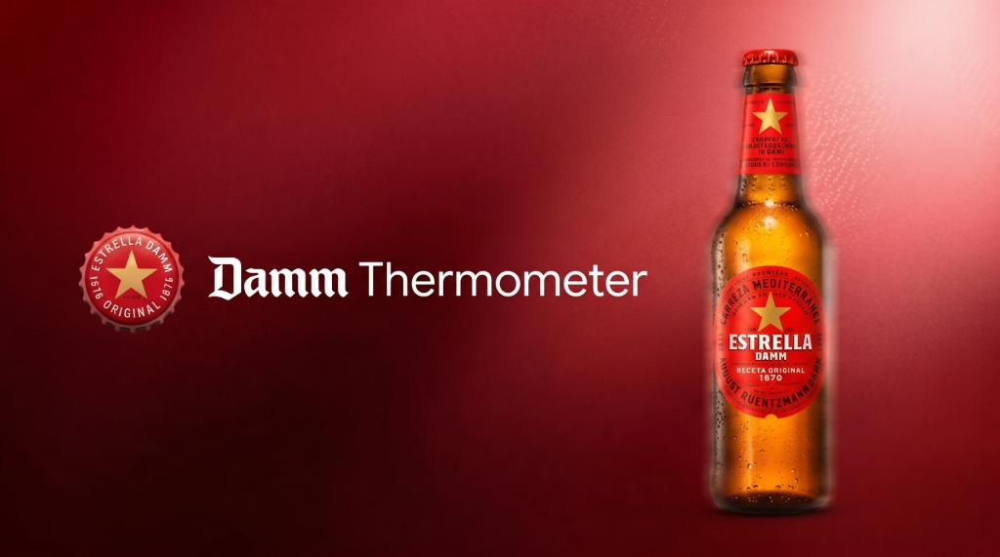
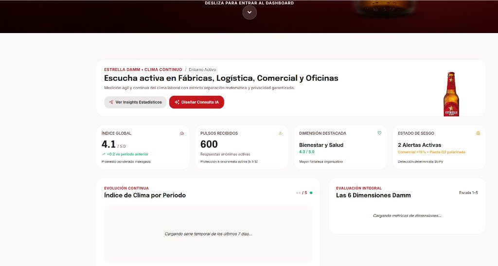
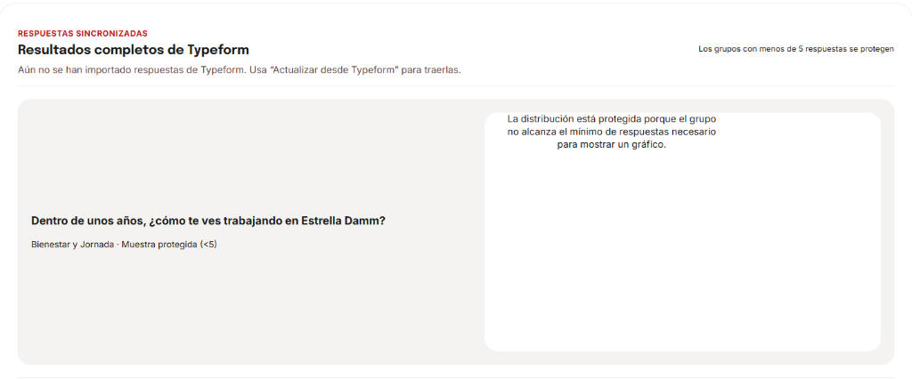
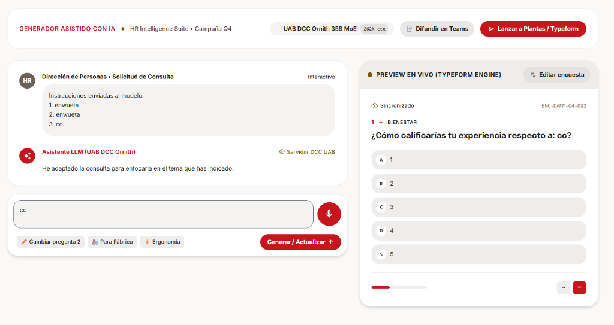
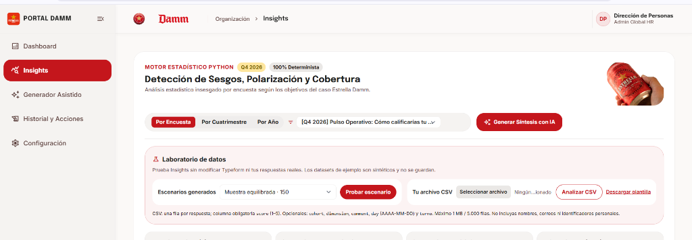
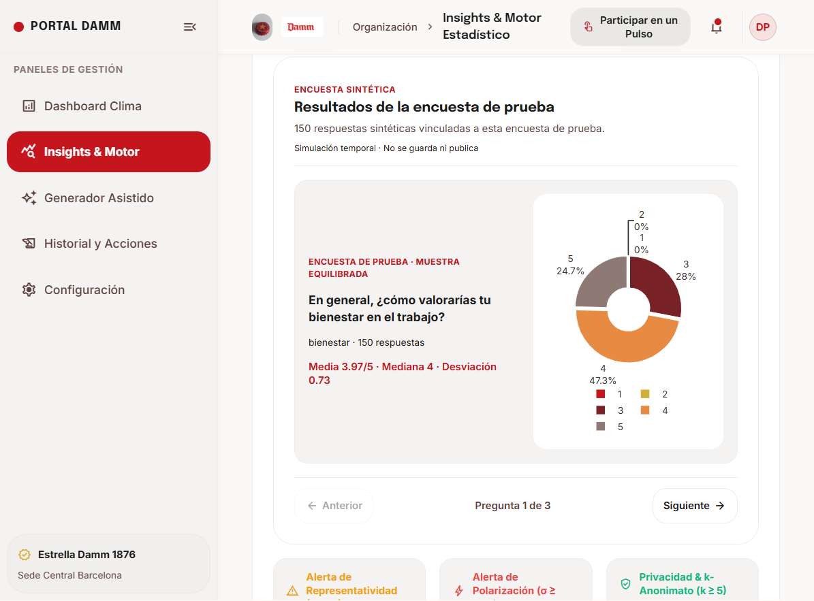
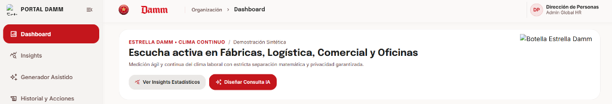
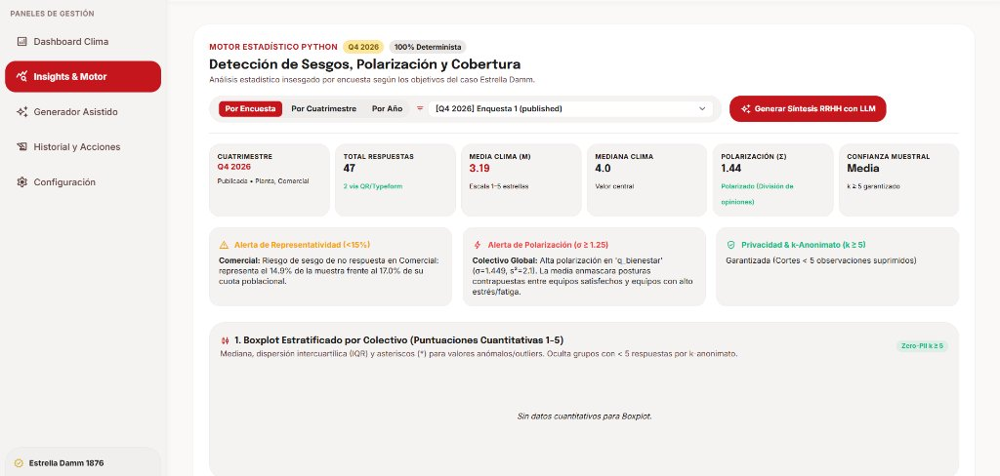
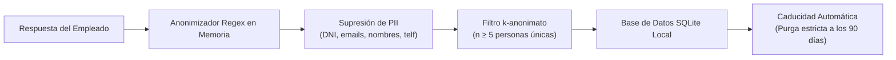

<div align="center">

# 🍺 Damm Thermometer

### Escuchar mejor. Entender antes. Actuar con criterio.

**Plataforma de escucha activa, analítica de clima continuo y People Analytics para Estrella Damm.**  
*Desarrollado para el reto corporativo de Estrella Damm en UAB THE HACK 2026.*

[](https://www.python.org/)
[](https://thehack.uab.cat/)
[](https://gdpr-info.eu/)
[](#-verificación)
[](LICENSE)

<br>

<p align="center">
  
</p>

<p align="center"><em>Medición ágil y continua del clima laboral con estricta separación matemática y privacidad garantizada.</em></p>

</div>

---

**Damm Thermometer** resuelve el reto de medir el clima laboral en organizaciones industriales complejas como **Estrella Damm**, donde conviven plantas de producción y envasado, cuadrillas logísticas en almacenes de alta rotación, personal comercial en movilidad constante y oficinas corporativas.

La arquitectura se fundamenta en un principio clave: **estricta separación entre el cálculo determinista y la asistencia con inteligencia artificial**.
* Los números, medias ponderadas censales, intervalos de confianza al 95% Bootstrap, detección de sesgos y alertas de polarización los calcula un **motor estadístico en Python (SciPy/NumPy)** de forma 100% reproducible y auditable.
* La **Inteligencia Artificial (DCC Ornith / Gemini)** asiste en el diseño de microconsultas en lenguaje natural o por dictado por voz y redacta síntesis estratégicas para RRHH sobre los datos reales calculados, garantizando **cero alucinaciones numéricas**.
* El **control humano (Human-in-the-Loop)** asegura que ninguna consulta ni acción de clima se ejecute sin la validación previa de la Dirección de Personas.

> 📋 **¿Eres miembro del jurado?**  
> Consulta el [resumen ejecutivo del proyecto](RESUMEN_JURADO.md) (1 min) y el [guion paso a paso de la demo](DEMO_SCRIPT.md) (3 min) con los escenarios oficiales de evaluación.

---

## 📑 Índice de Contenidos

1. [🖥️ Navegación y Portal Corporativo Damm](#1-️-navegación-y-portal-corporativo-damm)
2. [📊 Dashboard de Clima Continuo y Métricas Globales](#2--dashboard-de-clima-continuo-y-métricas-globales)
3. [🎙️ Generador Asistido con IA y Typeform Studio (Escuchar)](#3-️-generador-asistido-con-ia-y-typeform-studio-escuchar)
4. [📱 Despliegue Omnicanal para Cuadrillas y Fábricas (Llegar a todos)](#4--despliegue-omnicanal-para-cuadrillas-y-fábricas-llegar-a-todos)
5. [🔬 Motor Estadístico Determinista, Sesgos y Laboratorio (Entender)](#5--motor-estadístico-determinista-sesgos-y-laboratorio-entender)
6. [📈 Análisis Detallado por Pregunta y Distribución](#6--análisis-detallado-por-pregunta-y-distribución)
7. [🧠 Síntesis Estratégica con IA y Exportación a PDF Corporativo](#7--síntesis-estratégica-con-ia-y-exportación-a-pdf-corporativo)
8. [🛡️ Historial, Control Humano y Plan de Acción de RRHH (Actuar con criterio)](#8-️-historial-control-humano-y-plan-de-acción-de-rrhh-actuar-con-criterio)
9. [🔒 Privacidad, Anonimización y Cumplimiento Zero-PII (Proteger a las personas)](#9--privacidad-anonimización-y-cumplimiento-zero-pii-proteger-a-las-personas)
10. [🚀 Inicio Rápido](#10--inicio-rápido)
11. [🔌 Integraciones y Variables de Entorno](#11--integraciones-y-variables-de-entorno)
12. [🗂️ Estructura del Código Fuente](#12-️-estructura-del-código-fuente)
13. [✅ Verificación y Tests](#13--verificación-y-tests)

---

## 1. 🖥️ Navegación y Portal Corporativo Damm

El portal web de Damm Thermometer cuenta con un diseño unificado y corporativo basado en la identidad visual de **Estrella Damm 1876** (rojo carmín `#c4161c`, dorado cervecero `#ffd700` y tipografías legibles).

<p align="center">
  
</p>

### Aspectos clave:
* **Barra lateral fija y retráctil:** Acceso inmediato con un clic a las 5 secciones de la aplicación sin recargas:
  - **Dashboard:** Visión ejecutiva y evolución temporal del pulso de la organización.
  - **Generador Asistido:** Estudio interactivo para diseñar encuestas por prompt o voz.
  - **Insights:** Motor de detección de sesgos, análisis de cobertura censal y laboratorio de datos.
  - **Historial y Acciones:** Bandeja de aprobación de RRHH, seguimiento y auditoría.
  - **Configuración:** Conectores con modelos de lenguaje (UAB DCC Ornith / Gemini), Typeform y Teams.
* **Indicador de estado activo en rojo corporativo:** Cada sección activa se resalta visualmente, manteniendo en todo momento la orientación del analista de personas.
* **Encabezado institucional:** Identificación de la Dirección de Personas (Admin Global HR), selector de entorno y acceso al gestor de notificaciones de encuestas pendientes.

---

## 2. 📊 Dashboard de Clima Continuo y Métricas Globales

El **Dashboard** proporciona la fotografía en tiempo real del clima laboral en Estrella Damm, consolidando información de cuadrillas y turnos preservando el anonimato.

<p align="center">
  
</p>

### Funcionalidades detalladas:
* **Índice Global Insesgado (4.1 / 5.0):** Promedio ponderado según la representatividad demográfica de cada colectivo, corrigiendo la sobrerrepresentación de colectivos con mayor facilidad de acceso a terminales informáticos.
* **Pulsos Recibidos:** Contador de respuestas anónimas activas con garantía estricta de **$k$-anonimato ($k \ge 5$)**.
* **Evolución Continua:** Serie temporal interactiva por periodos para detectar tendencias tempranas y picos de malestar antes de que deriven en rotación o conflicto.
* **Las 6 Dimensiones Clave de Damm:** Evaluación desagregada en escala 1-5 de:
  1. *Bienestar y Salud Laboral*
  2. *Liderazgo y Claridad de Objetivos*
  3. *Seguridad y Condiciones Operativas*
  4. *Desarrollo y Crecimiento Profesional*
  5. *Reconocimiento y Sentido de Pertenencia*
  6. *Alineación con Valores Estrella Damm*

---

## 3. 🎙️ Generador Asistido con IA y Typeform Studio (Escuchar)

Permite a los técnicos de RRHH crear consultas de pulso adaptadas a cada colectivo en cuestión de segundos, sin necesidad de redactar preguntas desde cero.

<p align="center">
  
</p>

### Capacidades del generador:
* **Diseño mediante lenguaje natural:** El usuario escribe un objetivo (ej. *"Evaluar la carga física en el turno de noche de envasado y proponer mejoras en relevos"*) y la IA genera preguntas calibradas con escalas Likert y opciones balanceadas.
* **Dictado por voz local en streaming (Vosk):** Permite dictar instrucciones directamente con el micrófono mediante reconocimiento de voz en local sin enviar audio a APIs externas, respetando la privacidad.
* **Adaptación ergonómica por colectivo:**
  - **Fábrica, Logística y Comercial:** Microconsultas ultracortas (máximo 3 preguntas cerradas de 30 segundos).
  - **Oficinas Centrales:** Consultas completas con opción a pregunta de texto abierto anonimizada.
* **Typeform Studio con simulador en vivo:** Vista previa interactiva en móvil que permite probar el flujo de respuesta exacto antes de enviar la encuesta a revisión.

---

## 4. 📱 Despliegue Omnicanal para Cuadrillas y Fábricas (Llegar a todos)

En plantas cerveceras y almacenes, la mayoría de los trabajadores no dispone de un ordenador fijo ni correo electrónico de consulta frecuente durante su turno. Damm Thermometer elimina esta brecha comunicativa.

<table align="center" width="100%">
  <tr>
    <td align="center" width="35%">
      
      <br><strong>Código QR para Puntos Físicos</strong>
    </td>
    <td width="65%" style="vertical-align: top; padding-left: 20px;">
      <h4>Canales de despliegue simultáneo:</h4>
      <ul>
        <li><strong>Cartelería con Códigos QR:</strong> Colocación en vestuarios, comedores y paneles de relevo de turnos en Fábrica y Centros Logísticos para respuesta instantánea desde el móvil personal sin registro ni cookies.</li>
        <li><strong>Microconsultas vía Enlace Móvil / WhatsApp:</strong> Enlaces ultracortos enviados a personal comercial en ruta para contestar en 30 segundos al finalizar la jornada.</li>
        <li><strong>Adaptive Cards en Microsoft Teams:</strong> Notificaciones interactivas desplegadas en canales departamentales de Oficinas Centrales que permiten votar directamente dentro de Teams sin salir de la herramienta.</li>
        <li><strong>Kioscos Táctiles de Planta:</strong> Modalidad de acceso en pantallas comunes en zonas de descanso con reseteo automático de sesión tras cada respuesta.</li>
      </ul>
    </td>
  </tr>
</table>

---

## 5. 🔬 Motor Estadístico Determinista, Sesgos y Laboratorio (Entender)

El corazón analítico de Damm Thermometer es su **motor matemático determinista**, desarrollado con `scipy` y `numpy`. Funciona de forma 100% independiente de cualquier modelo de IA, asegurando rigor científico e inalterabilidad de los resultados.

<p align="center">
  
</p>

### Batería de análisis matemáticos:
* **Detección de Infrarrepresentación censal («¿Quién falta?»):** Compara la distribución de la muestra observada con el censo real de Estrella Damm:
  $$\text{Censo Oficial: } \text{Planta (46\%)}, \text{Logística (22\%)}, \text{Comercial (17\%)}, \text{Oficinas (10\%)}, \text{Mandos (5\%)}$$
  Si un colectivo no alcanza su cuota, el motor calcula el **déficit exacto en número de personas** y ajusta la media ponderada para evitar conclusiones sesgadas.
* **Detección de Polarización Bimodal ($\sigma \ge 1.25$):** Analiza la dispersión de las respuestas para identificar divisiones internas graves en una cuadrilla que quedarían ocultas tras una media engañosa (ej. una media de 3.0 formada por un 50% de notas 1 y un 50% de notas 5).
* **Intervalos de Confianza al 95% Bootstrap ($B=1000$):** Estimación robusta no paramétrica del rango real en el que se sitúa el clima laboral sin asumir normalidad poblacional.
* **Contraste de Significancia Estadística ($p$-valor SciPy):** Determina matemáticamente si una subida o bajada de clima respecto al periodo anterior es una variación real estadísticamente significativa ($p < 0.05$) o mero ruido muestral.
* **Laboratorio de Datos Aislado:** Permite a RRHH probar escenarios generados o cargar archivos CSV propios (hasta 5.000 filas) en un entorno *sandbox* de memoria sin escribir en la base de datos real ni alterar Typeform.

---

## 6. 📈 Análisis Detallado por Pregunta y Distribución

El sistema proporciona una inspección minuciosa de los resultados pregunta por pregunta mediante gráficos de distribución de frecuencias.

<p align="center">
  
</p>

### Métricas por reactivo:
* **Distribución de respuestas en escala Likert 1 a 5:** Visualización en gráfico de rosca interactivo (Plotly.js) para detectar consensos y asimetrías.
* **Métricas estadísticas clave:** Media aritmética, desviación típica ($\sigma$), número de respuestas válidas y tasa de participación por pregunta.
* **Filtros por periodo:** Visualización por encuesta puntual, cuatrimestre consolidado o año natural.

---

## 7. 🧠 Síntesis Estratégica con IA y Exportación a PDF Corporativo

Al pulsar **Generar Síntesis con IA**, el modelo de lenguaje **DCC Ornith** (UAB The Hack!) analiza la estructura de datos generada por el motor estadístico determinista y redacta un informe ejecutivo estructurado para el Comité de Dirección.

<p align="center">
  
</p>

### Estructura del Informe de Síntesis:
1. **Resumen Ejecutivo Cualitativo:** Diagnóstico global del pulso organizacional sin alucinaciones numéricas.
2. **Estudio Estadístico Riguroso:** Cinta de 4 KPIs ejecutivos y tabla comparativa censal con cálculo de déficit de respuestas por colectivo.
3. **Diagnóstico de Alertas Graves:** Identificación de colectivos vulnerables, turnos desconectados y dispersión bimodal.
4. **Plan de Acción Operativo (Bien Organizado):** Iniciativas concretas clasificadas por prioridad (*Prioridad Inmediata*, *Prioridad Alta*, *Seguimiento Continuo*) con colectivo objetivo, impacto proyectado y canal de comunicación recomendado.
5. **Propuesta de Microconsultas de Validación:** 2 preguntas en escala Likert recomendadas para medir el avance del plan en las siguientes semanas.

### Doble opción de Exportación a PDF:
* **Exportar PDF (Descarga Directa):** Genera y descarga automáticamente un documento en formato PDF corporativo A4 formal con membrete de Estrella Damm 1876, tabla censal y sellos de confidencialidad y Zero-PII.
* **Imprimir / Guardar como PDF:** Abre el motor de impresión nativo del navegador para exportación vectorial de alta definición sin pérdida de calidad tipográfica.

---

## 8. 🛡️ Historial, Control Humano y Plan de Acción de RRHH (Actuar con criterio)

Damm Thermometer incorpora un estricto protocolo **Human-in-the-Loop**: la IA propone y ayuda a redactar, pero **un técnico de RRHH siempre tiene la última palabra antes de cualquier lanzamiento**.

<p align="center">
  
</p>

### Control de gobernanza:
* **Flujo de Aprobación Obligatorio:** Las encuestas generadas con IA quedan en estado `Borrador / Pendiente de Aprobación`. Hasta que un analista humano no pulsa **Aprobar y Activar**, la encuesta no se publica en Typeform ni se generan sus códigos QR.
* **Trazabilidad y Auditoría:** Historial auditable con fecha, autor de la aprobación, colectivo destinatario y canal empleado.
* **Vinculación de Microconsultas de Impacto:** Posibilidad de activar encuestas de seguimiento a los 30 o 60 días para medir si una acción correctora (ej. mejora de climatización en muelles de carga) ha aumentado el clima del colectivo afectado.

---

## 9. 🔒 Privacidad, Anonimización y Cumplimiento Zero-PII (Proteger a las personas)

Para que los operarios de planta, conductores y comerciales compartan su opinión honesta, la confidencialidad debe estar blindada a nivel de código y arquitectura.

<div align="center">



</div>

### Salvaguardas técnicas implementadas:
1. **Protección por $k$-anonimato ($k \ge 5$):** Si un subgrupo, turno o cohorte tiene menos de 5 participantes únicos, sus métricas agregadas se bloquean y se muestran con el indicador `Protegido (n < 5)`.
2. **Anonimización Zero-PII en comentarios abiertos:** Antes de almacenar cualquier comentario de texto libre en la base de datos o enviarlo al modelo de lenguaje, un depurador basado en expresiones regulares elimina automáticamente:
   - Direcciones de correo electrónico (`[EMAIL_ELIMINADO]`).
   - Teléfonos nacionales e internacionales (`[TELÉFONO_ELIMINADO]`).
   - Números de identificación fiscal DNI/NIE (`[DNI_ELIMINADO]`).
   - Códigos de cuenta bancaria e IBAN (`[IBAN_ELIMINADO]`).
   - Nombres propios detectados mediante patrones contextuales.
3. **Caducidad estricta a los 90 días:** Política de retención de datos temporal con purga programada en SQLite.
4. **Arquitectura local de escucha:** El servidor funciona en `127.0.0.1` de forma soberana, almacenando las respuestas en base de datos local sin dependencias de almacenamiento en la nube ni trackers de terceros.

---

## 10. 🚀 Inicio Rápido

### Requisitos previos
* **Python 3.10 o superior** instalado en el sistema.
* Git instalado.

### Instalación en Windows (PowerShell)

```powershell
# 1. Clonar el repositorio
git clone https://github.com/IgnaciDM/Damn.git
cd Damn

# 2. Crear y activar el entorno virtual
python -m venv .venv
.\.venv\Scripts\Activate.ps1

# 3. Instalar dependencias del proyecto
python -m pip install --upgrade pip
python -m pip install -r requirements.txt

# 4. Iniciar la aplicación
python -m backend.app
```

### Instalación en Linux / macOS (Bash / Zsh)

```bash
# 1. Clonar el repositorio
git clone https://github.com/IgnaciDM/Damn.git
cd Damn

# 2. Crear y activar el entorno virtual
python3 -m venv .venv
source .venv/bin/activate

# 3. Instalar dependencias
pip install -r requirements.txt

# 4. Iniciar la aplicación
python3 -m backend.app
```

Una vez iniciado el servidor, abre tu navegador en:  
👉 **[http://127.0.0.1:8000](http://127.0.0.1:8000)** (o el puerto configurado en tu variable `PORT`).

*La aplicación incluye datos sintéticos precargados para que puedas probar todas las funcionalidades inmediatamente sin necesidad de configurar APIs externas.*

---

## 11. 🔌 Integraciones y Variables de Entorno

Para conectar Damm Thermometer a servicios reales de producción, copia la plantilla de configuración:

```bash
cp .env.example .env
```

| Variable de Entorno | Descripción | Obligatorio | Modo por Defecto |
|---|---|:---:|---|
| `UTH_KEY` | Clave de acceso a la API del modelo DCC Ornith (UAB The Hack!). | No | Síntesis local determinista si no está configurada |
| `AI_MODEL` | Nombre del modelo LLM (por defecto `dcc-ornith-hack`). | No | `dcc-ornith-hack` |
| `AI_BASE_URL` | Endpoint HTTP del servicio de IA de la UAB. | No | Endpoint oficial UTH |
| `GEMINI_API_KEY` | Clave de API de Google Gemini (proveedor alternativo). | No | No habilitado |
| `TYPEFORM_API_TOKEN` | Token personal de Typeform para publicar y recolectar encuestas. | No | Modo simulación interactiva local |
| `TEAMS_WEBHOOK_URL` | Webhook de Microsoft Teams para publicar Adaptive Cards en canales. | No | Generación de payload JSON sin envío |
| `VOSK_MODEL_PATH` | Ruta local al modelo de reconocimiento de voz Vosk en español. | No | Entrada de texto estándar |
| `THERMOMETER_DATABASE` | Ruta a la base de datos SQLite local. | No | `data/thermometer.db` |
| `PORT` | Puerto de escucha del servidor HTTP Python. | No | `8000` |

---

## 12. 🗂️ Estructura del Código Fuente

```text
Damn/
├── backend/
│   ├── app.py                   # Enrutador HTTP principal y gestión de endpoints REST
│   ├── common.py                # Base de datos SQLite, esquemas, anonimizador Zero-PII y constantes
│   ├── dashboard.py             # Lógica de agregación del clima y preservación de k-anonimato
│   ├── generator.py             # Generador asistido con IA, dictado Vosk y tarjetas Teams
│   ├── insights.py              # Controlador de análisis estadístico, sesgos y síntesis con LLM
│   ├── statistics_engine.py     # Motor estadístico determinista puro (Bootstrap, SciPy, Chi-cuadrado)
│   ├── admin.py                 # Bandeja de aprobación humana, auditoría de campañas y exportaciones
│   ├── settings.py              # Conectores y persistencia de credenciales de IA y Typeform
│   └── scripts/
│       └── qrgenerator.py       # Utilidad para generación de códigos QR de encuestas
├── ui/
│   ├── index.html               # Aplicación web SPA completa (Dashboard, IA, Insights, Admin)
│   ├── styles.css               # Reglas de estilo y temas corporativos Estrella Damm
│   └── assets/                  # Logos corporativos, chapas, imágenes y capturas del README
├── dataset/
│   └── dataset_generator.py     # Generador de datos sintéticos representativos de la plantilla Damm
├── test_dataset/
│   ├── *.csv                    # Datasets de prueba con escenarios de polarización y sesgo
│   ├── expected_checks.json     # Valores matemáticos esperados para contrastar los cálculos
│   └── invalid_payloads.json    # Casos límite de entrada inválida
├── tests/
│   ├── test_app.py              # 23 tests de endpoints REST, seguridad y concurrencia
│   └── test_statistical_engine.py # 33 tests del motor estadístico y validación matemática
├── DEMO_SCRIPT.md               # Guion guiado para la presentación del jurado (3 minutos)
├── RESUMEN_JURADO.md            # Ficha técnica y resumen del proyecto para evaluadores
├── requirements.txt             # Dependencias de Python (numpy, scipy, vosk, typeform, etc.)
└── LICENSE                      # Licencia PolyForm Free Trial 1.0.0
```

---

## 13. ✅ Verificación y Tests

El proyecto cuenta con una cobertura de pruebas exhaustiva que valida tanto las rutas de la API como el comportamiento matemático del motor determinista.

Para ejecutar los 56 tests unitarios y de integración:

```powershell
python -m unittest discover -s tests -v
```

Resultado de la verificación:
```text
Ran 56 tests in 2.2s

OK (56/56 tests passing)
- test_app.py: 23 tests (Rutas, validación k-anonimato, anonimización regex, persistencia)
- test_statistical_engine.py: 33 tests (Bootstrap, polarización bimodal, significancia, déficit censal)
```

---

## 📄 Licencia

Este proyecto está bajo los términos de la licencia **PolyForm Free Trial 1.0.0**. Para más información, consulta el archivo [LICENSE](LICENSE).

---

<div align="center">
  <sub>Diseñado con pasión cervecera y rigor científico para <strong>Estrella Damm</strong> • UAB THE HACK 2026</sub>
</div>
